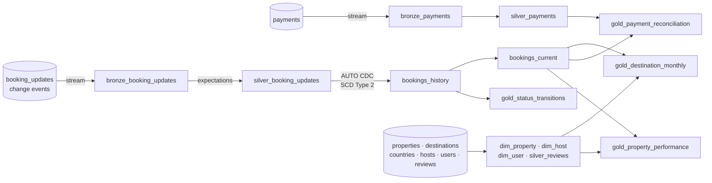

# Wanderbricks Booking Lakehouse

A Lakeflow declarative pipeline on Databricks for **Wanderbricks**, a travel booking platform
(Databricks' sample dataset: 72k bookings, 83k booking change events, 50k payments, 100k
reviews, 18k properties in 42 destinations).

The interesting part is the booking change log. Bookings move between states (pending,
confirmed, cancelled) and every change arrives as an event. The pipeline turns that log into a
full **SCD Type 2 history** with Auto CDC, then answers questions the current-state table can't:
how bookings move between states, how long confirmation takes, and which bookings have the
wrong amount of money against them.

**Stack:** Databricks Free Edition (serverless) · Lakeflow Spark Declarative Pipelines (SQL) ·
Auto CDC · Delta Lake · Unity Catalog · expectations · Databricks Asset Bundles · Lakeflow Jobs



## Layers

| Layer | Dataset | Type | What it holds |
|---|---|---|---|
| Bronze | `bronze_booking_updates` | streaming table | Change events as received, loaded incrementally |
| Bronze | `bronze_payments` | streaming table | Payments as received |
| Silver | `silver_booking_updates` | streaming table | Validated events, typed, status normalised, nights computed |
| Silver | `bookings_history` | streaming table (Auto CDC) | Every version of every booking with `__START_AT` / `__END_AT` |
| Silver | `bookings_current` | materialized view | Latest version of each booking |
| Silver | `dim_property`, `dim_host`, `dim_user` | materialized views | Dimensions; names, e-mails and phone numbers are not carried over |
| Silver | `silver_payments`, `silver_reviews` | materialized views | Valid payments; reviews that were not deleted |
| Gold | `gold_destination_monthly` | materialized view | Bookings, revenue and cancellation rate by destination and month |
| Gold | `gold_status_transitions` | materialized view | From-status → to-status counts and average hours between |
| Gold | `gold_payment_reconciliation` | materialized view | Per booking: due, paid, and `ok` / `confirmed_not_paid` / `cancelled_but_paid` / `amount_mismatch` |
| Gold | `gold_property_performance` | materialized view | Per property: bookings, revenue, nights sold, cancellation rate, rating |

## Data quality

Expectations are declared on the tables themselves, and their pass and fail counts appear in the
pipeline's data quality tab after every update.

| Table | Rule | On violation |
|---|---|---|
| silver_booking_updates | booking id and update time present | drop row |
| silver_booking_updates | check-out after check-in | drop row |
| silver_booking_updates | amount not negative | drop row |
| silver_booking_updates | guests > 0, updated after created | keep and count |
| silver_payments | booking id present, amount > 0 | drop row |
| silver_reviews | rating between 0 and 5 | drop row |
| dim_property | destination present, base price > 0 | keep and count |

Change events can arrive out of order. `SEQUENCE BY STRUCT(updated_at, booking_update_id)` lets
Auto CDC put them back in order, with the update id breaking ties between changes made in the
same second.

## Run it

1. In Databricks, add this repository as a **Git folder** (Workspace → Create → Git folder).
2. Open `databricks.yml` in the Git folder and select **Deploy**. This creates the schema
   `workspace.wanderbricks_lakehouse`, the pipeline and a daily job (paused).
3. Open the pipeline and select **Run pipeline**.

With the CLI instead:

```bash
databricks bundle deploy -t dev
databricks bundle run wanderbricks_lakehouse -t dev
```

Source data: `samples.wanderbricks`, available in every Databricks workspace including Free Edition.
